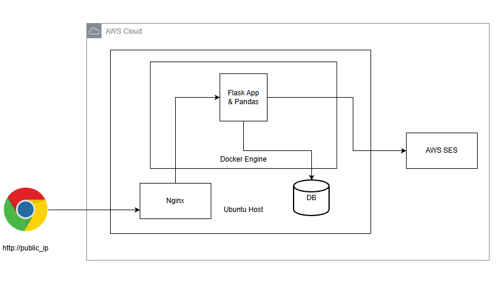

# bootcamp-file-processing
The project is to showcase the docker, flask, pandas, nginx, jinja2, postgres and ses service as a system.

### Procedure
1. Build the image
`docker build -t data-processor:v1 .`

2. Run the container
`docker run -d \
  --name data-processor \
  -p 127.0.0.1:5000:5000 \
  data-processor:v1`

3. Test locally on the host machine.
`curl http://localhost:5000/health`

4. Install Nginx on the host
```bash
sudo apt update

sudo apt install nginx -y
```

5. Configure Nginx as reverse proxy
`sudo nano /etc/nginx/sites-available/default`

```bash
server {

    listen 80;

    server_name _;

    location / {

        proxy_pass http://127.0.0.1:5000;

        proxy_set_header Host $host;

        proxy_set_header X-Real-IP $remote_addr;

        proxy_set_header X-Forwarded-For $proxy_add_x_forwarded_for;

        proxy_set_header X-Forwarded-Proto $scheme;

    }

}
```

6. Restart Nginx and try using the public IP
`http://YOUR_SERVER_PUBLIC_IP/`

### Architecture
